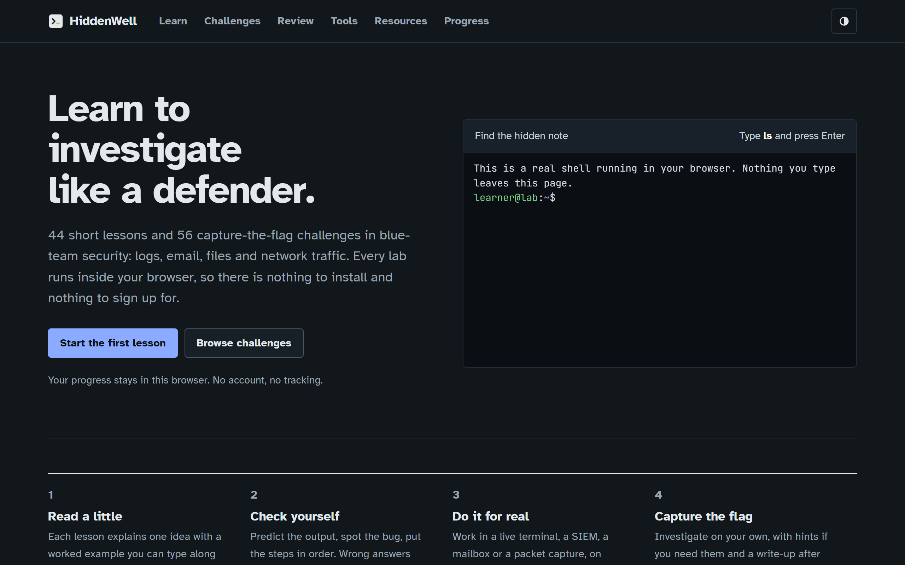
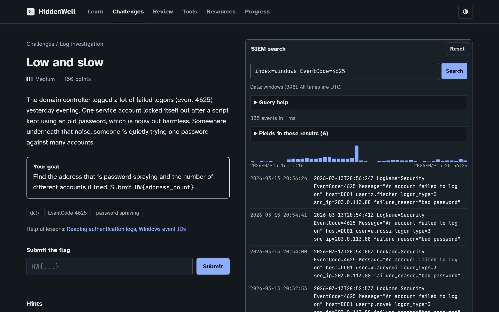
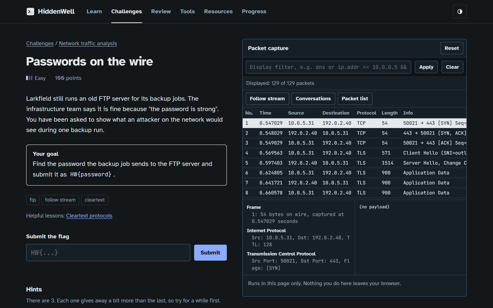
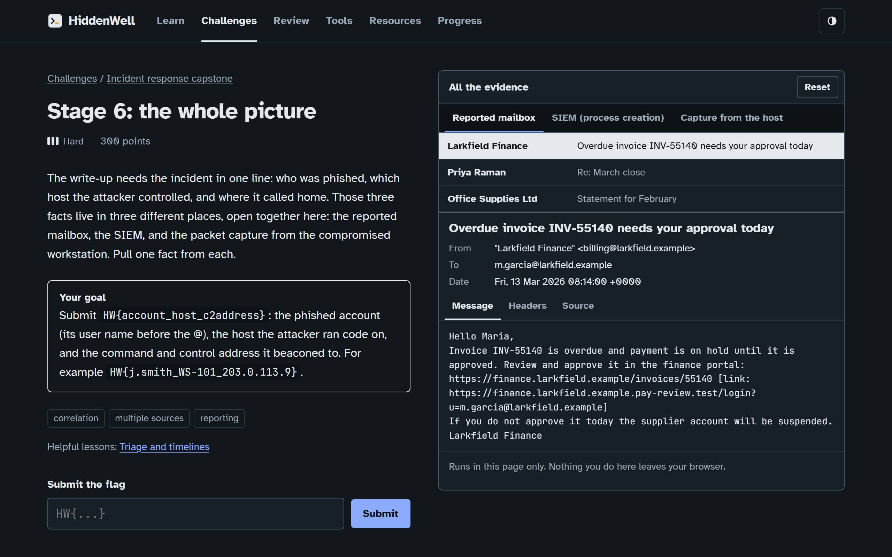
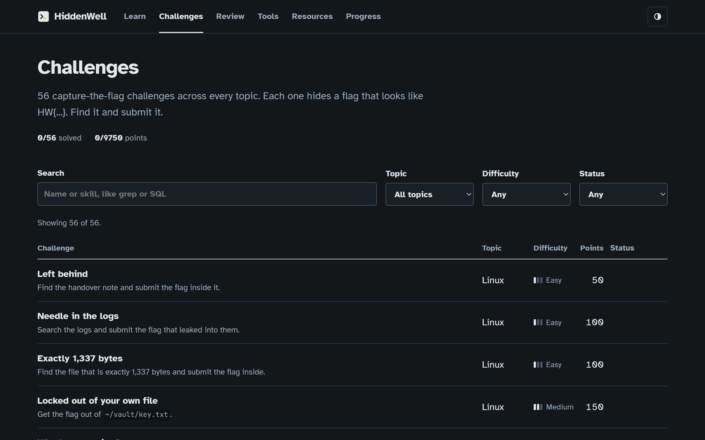

<p align="center">
  
</p>

<h1 align="center">HiddenWell</h1>

<p align="center">
  <b>A blue-team CTF that runs entirely in your browser.</b><br>
  Investigate logs, phishing emails, files and packet captures. Find the flag.
</p>

<p align="center">
  
  
  
  
</p>

<p align="center">
  
</p>

## What it is

Short lessons, then capture-the-flag challenges built on synthetic evidence. No install, no account, no server. Your progress stays in your browser.

| Topic | You investigate |
| --- | --- |
| Linux | Files, permissions and pipelines in a real in-browser shell |
| Logs | Brute force, password spraying and beacons in a SIEM |
| Email | Headers, SPF/DKIM/DMARC, lookalike domains, attachments |
| Forensics | Signatures, hashes, metadata, timelines, carving |
| Network | Handshakes, scans, DNS tunnelling, cleartext, exfiltration |
| Code review | Injection, XSS, access control, secrets, path traversal |
| CVEs | KEV triage, Log4Shell, WannaCry, exposure windows |
| Capstone | One incident, end to end, across every source |

## Inside

<table>
  <tr>
    <td width="50%"><p align="center"><b>SIEM</b> with its own query language</p></td>
    <td width="50%"><p align="center"><b>Packet viewer</b> with filters and follow stream</p></td>
  </tr>
  <tr>
    <td width="50%"><p align="center"><b>Capstone</b> across mailbox, SIEM and capture</p></td>
    <td width="50%"><p align="center"><b>56 challenges</b>, easy to hard</p></td>
  </tr>
</table>

## Run it

```bash
npm start      # http://localhost:8080
npm test       # 99 tests
```

Node 20+. No dependencies, no build step. Deploys as a static site.

## How it works

- **Everything is client side.** The shell, SIEM, mailbox and packet viewer are plain ES modules working on evidence generated in the page.
- **No plaintext flags.** Flags are sealed in the source and only unsealed to check an answer. A test fails the build if one ever leaks.
- **Every challenge is proven solvable.** The test suite solves all 56 through their intended path.
- **Locked down.** Strict Content Security Policy, no network access, no tracking.

## License

MIT. Fonts: Atkinson Hyperlegible and JetBrains Mono (SIL OFL).
